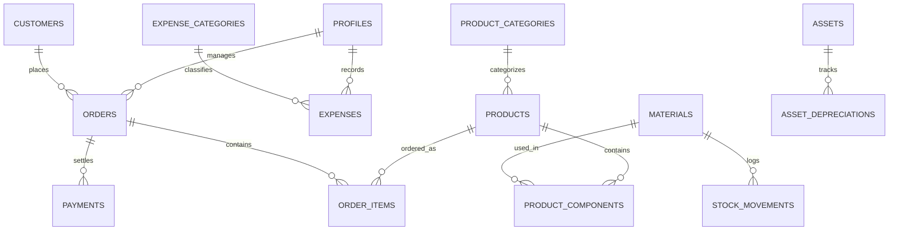

# Casa Moral 3D Printing Business Management System — Database Design

Dokumen ini merancang skema relasional PostgreSQL melalui Supabase untuk sistem manajemen bisnis Casa Moral.

---

## 1. Entity-Relationship Diagram (ERD)



---

## 2. Struktur Tabel & Skema Relasional

### 2.1 Master & Pengguna

#### `profiles` (Sinkronisasi dengan `auth.users`)
- `id`: UUID PRIMARY KEY REFERENCES auth.users(id) ON DELETE CASCADE
- `full_name`: TEXT NOT NULL
- `role`: TEXT NOT NULL DEFAULT 'admin' CHECK (role IN ('owner', 'admin', 'operator'))
- `created_at`: TIMESTAMPTZ NOT NULL DEFAULT NOW()
- `updated_at`: TIMESTAMPTZ NOT NULL DEFAULT NOW()

#### `customers`
- `id`: UUID PRIMARY KEY DEFAULT gen_random_uuid()
- `name`: TEXT NOT NULL
- `phone`: TEXT
- `address`: TEXT
- `city`: TEXT
- `channel_source`: TEXT DEFAULT 'Direct' -- 'Direct', 'Shopee', 'WhatsApp', 'Instagram'
- `created_at`: TIMESTAMPTZ NOT NULL DEFAULT NOW()
- `updated_at`: TIMESTAMPTZ NOT NULL DEFAULT NOW()

---

### 2.2 Inventaris, Bahan Baku & Aset

#### `materials` (Bahan Baku Filamen & Komponen Perakitan)
- `id`: UUID PRIMARY KEY DEFAULT gen_random_uuid()
- `name`: TEXT NOT NULL -- e.g., 'Filamen eSUN PETG Clear', 'Fitting E27', 'Bohlam 3W'
- `category`: TEXT NOT NULL CHECK (category IN ('filament', 'electrical', 'packaging', 'hardware', 'other'))
- `unit`: TEXT NOT NULL -- 'gram', 'pcs', 'meter', 'roll'
- `current_stock`: NUMERIC(12, 2) NOT NULL DEFAULT 0 CHECK (current_stock >= 0)
- `min_stock_alert`: NUMERIC(12, 2) DEFAULT 0
- `cost_per_unit`: NUMERIC(15, 2) NOT NULL DEFAULT 0
- `supplier`: TEXT
- `created_at`: TIMESTAMPTZ NOT NULL DEFAULT NOW()
- `updated_at`: TIMESTAMPTZ NOT NULL DEFAULT NOW()

#### `stock_movements` (Audit Trail Mutasi Stok)
- `id`: UUID PRIMARY KEY DEFAULT gen_random_uuid()
- `material_id`: UUID NOT NULL REFERENCES materials(id) ON DELETE CASCADE
- `movement_type`: TEXT NOT NULL CHECK (movement_type IN ('PURCHASE', 'PRODUCTION_USAGE', 'WASTE_ADJUSTMENT', 'MANUAL_CORRECTION', 'RETURN'))
- `quantity`: NUMERIC(12, 2) NOT NULL -- Positif jika masuk, negatif jika keluar
- `reference_id`: UUID -- ID pesanan (order_id) atau ID pengeluaran (expense_id)
- `notes`: TEXT
- `created_at`: TIMESTAMPTZ NOT NULL DEFAULT NOW()

#### `assets` (Printer 3D & Alat Kerja)
- `id`: UUID PRIMARY KEY DEFAULT gen_random_uuid()
- `name`: TEXT NOT NULL -- e.g., 'Mesin Bambulab A1 Mini', 'Anycubic Kobra X'
- `category`: TEXT NOT NULL CHECK (category IN ('printer_3d', 'tool', 'computer', 'furniture'))
- `purchase_date`: DATE NOT NULL DEFAULT CURRENT_DATE
- `purchase_price`: NUMERIC(15, 2) NOT NULL CHECK (purchase_price > 0)
- `residual_value`: NUMERIC(15, 2) NOT NULL DEFAULT 0
- `useful_life_months`: INT NOT NULL DEFAULT 24 CHECK (useful_life_months > 0)
- `estimated_hours_per_month`: NUMERIC(8, 2) DEFAULT 150
- `power_watts`: NUMERIC(8, 2) DEFAULT 100
- `status`: TEXT NOT NULL DEFAULT 'ACTIVE' CHECK (status IN ('ACTIVE', 'MAINTENANCE', 'RETIRED'))
- `created_at`: TIMESTAMPTZ NOT NULL DEFAULT NOW()

---

### 2.3 Produk & Kalkulasi HPP

#### `product_categories`
- `id`: UUID PRIMARY KEY DEFAULT gen_random_uuid()
- `name`: TEXT NOT NULL UNIQUE -- e.g., 'Ambient Lamp', 'Keychains', 'Ornament'
- `created_at`: TIMESTAMPTZ NOT NULL DEFAULT NOW()

#### `products`
- `id`: UUID PRIMARY KEY DEFAULT gen_random_uuid()
- `sku`: TEXT UNIQUE
- `name`: TEXT NOT NULL -- e.g., 'Lampu Ambient - Lumi', 'Ollie', 'Kumo', 'Pomi'
- `category_id`: UUID REFERENCES product_categories(id) ON DELETE SET NULL
- `description`: TEXT
- `dimensions`: JSONB -- e.g., {"height_mm": 180, "width_mm": 163, "shade_height_mm": 80}
- `calculation_mode`: TEXT NOT NULL DEFAULT 'STANDARD' CHECK (calculation_mode IN ('STANDARD', 'ADVANCED'))
- `standard_overhead_multiplier`: NUMERIC(5, 2) DEFAULT 1.20
- `print_time_minutes`: NUMERIC(8, 2) DEFAULT 0
- `current_hpp`: NUMERIC(15, 2) NOT NULL DEFAULT 0
- `recommended_price`: NUMERIC(15, 2) NOT NULL DEFAULT 0
- `selling_price`: NUMERIC(15, 2) NOT NULL DEFAULT 0
- `markup_percent`: NUMERIC(5, 2) DEFAULT 50.00
- `is_active`: BOOLEAN NOT NULL DEFAULT TRUE
- `created_at`: TIMESTAMPTZ NOT NULL DEFAULT NOW()
- `updated_at`: TIMESTAMPTZ NOT NULL DEFAULT NOW()

#### `product_components` (Bill of Materials / BOM per Produk)
- `id`: UUID PRIMARY KEY DEFAULT gen_random_uuid()
- `product_id`: UUID NOT NULL REFERENCES products(id) ON DELETE CASCADE
- `component_type`: TEXT NOT NULL CHECK (component_type IN ('SHADE', 'BASE', 'CAP', 'ELECTRICAL', 'PACKAGING', 'ACCESSORY'))
- `material_id`: UUID REFERENCES materials(id) ON DELETE RESTRICT
- `quantity`: NUMERIC(8, 2) NOT NULL -- gramatur filamen atau jumlah pcs komponen
- `unit_cost_snapshot`: NUMERIC(15, 2) NOT NULL
- `subtotal_cost`: NUMERIC(15, 2) NOT NULL
- `created_at`: TIMESTAMPTZ NOT NULL DEFAULT NOW()

---

### 2.4 Pesanan, Penjualan & Pembayaran

#### `orders`
- `id`: UUID PRIMARY KEY DEFAULT gen_random_uuid()
- `order_number`: TEXT NOT NULL UNIQUE -- e.g., 'CM-202610-001'
- `order_date`: TIMESTAMPTZ NOT NULL DEFAULT NOW()
- `customer_id`: UUID REFERENCES customers(id) ON DELETE SET NULL
- `channel`: TEXT NOT NULL DEFAULT 'Direct' CHECK (channel IN ('Direct', 'Shopee', 'WhatsApp', 'Other'))
- `status`: TEXT NOT NULL DEFAULT 'PENDING' CHECK (status IN ('PENDING', 'CONFIRMED', 'IN_PRODUCTION', 'READY', 'SHIPPED', 'COMPLETED', 'CANCELLED'))
- `subtotal_amount`: NUMERIC(15, 2) NOT NULL DEFAULT 0
- `add_on_amount`: NUMERIC(15, 2) NOT NULL DEFAULT 0
- `discount_amount`: NUMERIC(15, 2) NOT NULL DEFAULT 0
- `shipping_cost`: NUMERIC(15, 2) NOT NULL DEFAULT 0
- `platform_fee`: NUMERIC(15, 2) NOT NULL DEFAULT 0
- `total_amount`: NUMERIC(15, 2) NOT NULL DEFAULT 0
- `payment_status`: TEXT NOT NULL DEFAULT 'UNPAID' CHECK (payment_status IN ('UNPAID', 'PARTIALLY_PAID', 'PAID', 'REFUNDED'))
- `paid_amount`: NUMERIC(15, 2) NOT NULL DEFAULT 0
- `notes`: TEXT
- `created_at`: TIMESTAMPTZ NOT NULL DEFAULT NOW()
- `updated_at`: TIMESTAMPTZ NOT NULL DEFAULT NOW()

#### `order_items` (Snapshot Transaksi)
- `id`: UUID PRIMARY KEY DEFAULT gen_random_uuid()
- `order_id`: UUID NOT NULL REFERENCES orders(id) ON DELETE CASCADE
- `product_id`: UUID REFERENCES products(id) ON DELETE RESTRICT
- `quantity`: INT NOT NULL CHECK (quantity > 0)
- `unit_price`: NUMERIC(15, 2) NOT NULL -- Snapshot harga jual
- `unit_hpp`: NUMERIC(15, 2) NOT NULL -- Snapshot HPP saat transaksi
- `color_details`: TEXT -- e.g., 'Base Oren + Shade Putih + Cap Oren'
- `add_on_name`: TEXT -- e.g., 'Cap Custom Figur Lee Jeno'
- `add_on_price`: NUMERIC(15, 2) DEFAULT 0
- `subtotal`: NUMERIC(15, 2) NOT NULL
- `created_at`: TIMESTAMPTZ NOT NULL DEFAULT NOW()

#### `payments` (Riwayat Kas Masuk)
- `id`: UUID PRIMARY KEY DEFAULT gen_random_uuid()
- `order_id`: UUID NOT NULL REFERENCES orders(id) ON DELETE RESTRICT
- `payment_date`: TIMESTAMPTZ NOT NULL DEFAULT NOW()
- `amount`: NUMERIC(15, 2) NOT NULL CHECK (amount > 0)
- `payment_method`: TEXT NOT NULL DEFAULT 'TRANSFER' CHECK (payment_method IN ('TRANSFER', 'CASH', 'SHOPEE_PAYOUT', 'QRIS'))
- `reference_number`: TEXT
- `proof_url`: TEXT
- `notes`: TEXT
- `created_at`: TIMESTAMPTZ NOT NULL DEFAULT NOW()

---

### 2.5 Pengeluaran Operasional & Modal

#### `expense_categories`
- `id`: UUID PRIMARY KEY DEFAULT gen_random_uuid()
- `name`: TEXT NOT NULL UNIQUE -- e.g., 'Marketing/Ads', 'Electricity & Internet', 'Rent', 'Tools/Maintenance'
- `is_fixed_cost`: BOOLEAN NOT NULL DEFAULT TRUE -- Untuk kalkulasi BEP
- `created_at`: TIMESTAMPTZ NOT NULL DEFAULT NOW()

#### `expenses`
- `id`: UUID PRIMARY KEY DEFAULT gen_random_uuid()
- `expense_date`: DATE NOT NULL DEFAULT CURRENT_DATE
- `category_id`: UUID REFERENCES expense_categories(id) ON DELETE RESTRICT
- `description`: TEXT NOT NULL
- `amount`: NUMERIC(15, 2) NOT NULL CHECK (amount > 0)
- `payment_method`: TEXT DEFAULT 'TRANSFER'
- `is_capital_expenditure`: BOOLEAN NOT NULL DEFAULT FALSE -- Pembeda Aset/Capex vs Beban Opex
- `notes`: TEXT
- `created_at`: TIMESTAMPTZ NOT NULL DEFAULT NOW()

---

## 3. Skema Revisi & Modul Baru (Migration `20261015000002_revisions_and_payables.sql`)

### 3.1 Ekstensi Tabel `products`
Mendukung pemisahan antara Produk Induk (misal: Lampu Ambient, Dekorasi 3D, Aksesori, Custom) dengan Model/Varian:
- `parent_id`: UUID REFERENCES products(id) ON DELETE SET NULL
- `product_type`: TEXT NOT NULL DEFAULT 'STANDARD' CHECK (product_type IN ('STANDARD', 'MODEL_VARIANT', 'CUSTOM', 'PURCHASED'))
- `color_variants`: JSONB DEFAULT '[]'::jsonb
- `custom_attributes`: JSONB DEFAULT '{}'::jsonb
- `pricing_source`: TEXT NOT NULL DEFAULT 'INDIVIDUAL' CHECK (pricing_source IN ('GLOBAL', 'CATEGORY', 'INDIVIDUAL'))

### 3.2 Tabel `business_settings`
Menyimpan konfigurasi bisnis persisten per pengguna:
- `id`: UUID PRIMARY KEY DEFAULT gen_random_uuid()
- `key`: TEXT NOT NULL UNIQUE (e.g. `marketplace_fees`, `global_pricing`, `production_assumptions`)
- `value`: JSONB NOT NULL
- `description`: TEXT
- `updated_by`: UUID REFERENCES auth.users(id)
- `updated_at`: TIMESTAMPTZ NOT NULL DEFAULT NOW()

### 3.3 Tabel `payables` (Utang Usaha & Cicilan Pembiayaan)
- `id`: UUID PRIMARY KEY DEFAULT gen_random_uuid()
- `title`: TEXT NOT NULL
- `creditor_name`: TEXT NOT NULL (e.g. 'Shopee PayLater', 'Supplier Filamen')
- `payable_type`: TEXT NOT NULL CHECK (payable_type IN ('ASSET_PURCHASE', 'OPERATIONAL_DEBT', 'RAW_MATERIAL', 'OTHER'))
- `total_amount`: NUMERIC(15, 2) NOT NULL CHECK (total_amount > 0)
- `paid_amount`: NUMERIC(15, 2) NOT NULL DEFAULT 0 CHECK (paid_amount >= 0)
- `remaining_amount`: NUMERIC(15, 2) NOT NULL CHECK (remaining_amount >= 0)
- `start_date`: DATE NOT NULL
- `due_date`: DATE NOT NULL
- `status`: TEXT NOT NULL DEFAULT 'UNPAID' CHECK (status IN ('UNPAID', 'PARTIALLY_PAID', 'PAID', 'OVERDUE'))
- `asset_id`: UUID REFERENCES assets(id) ON DELETE SET NULL
- `notes`: TEXT
- `created_at`: TIMESTAMPTZ NOT NULL DEFAULT NOW()

### 3.4 Tabel `payable_installments` (Rincian Angsuran Terjadwal)
- `id`: UUID PRIMARY KEY DEFAULT gen_random_uuid()
- `payable_id`: UUID NOT NULL REFERENCES payables(id) ON DELETE CASCADE
- `installment_number`: INTEGER NOT NULL
- `due_date`: DATE NOT NULL
- `amount`: NUMERIC(15, 2) NOT NULL CHECK (amount > 0)
- `paid_amount`: NUMERIC(15, 2) NOT NULL DEFAULT 0 CHECK (paid_amount >= 0)
- `status`: TEXT NOT NULL DEFAULT 'UNPAID' CHECK (status IN ('UNPAID', 'PAID', 'OVERDUE', 'PARTIALLY_PAID'))
- `paid_date`: DATE
- `payment_method`: TEXT
- `reference_number`: TEXT
- `notes`: TEXT
- `created_at`: TIMESTAMPTZ NOT NULL DEFAULT NOW()

---

## 4. Row Level Security (RLS) Strategy

Seluruh tabel PostgreSQL mengaktifkan `ROW LEVEL SECURITY`:
```sql
ALTER TABLE profiles ENABLE ROW LEVEL SECURITY;
ALTER TABLE products ENABLE ROW LEVEL SECURITY;
ALTER TABLE materials ENABLE ROW LEVEL SECURITY;
ALTER TABLE orders ENABLE ROW LEVEL SECURITY;
ALTER TABLE order_items ENABLE ROW LEVEL SECURITY;
ALTER TABLE payments ENABLE ROW LEVEL SECURITY;
ALTER TABLE expenses ENABLE ROW LEVEL SECURITY;
ALTER TABLE assets ENABLE ROW LEVEL SECURITY;
ALTER TABLE payables ENABLE ROW LEVEL SECURITY;
ALTER TABLE payable_installments ENABLE ROW LEVEL SECURITY;
ALTER TABLE business_settings ENABLE ROW LEVEL SECURITY;
```

Kebijakan akses berbasis user terotentikasi:
- `SELECT / INSERT / UPDATE / DELETE`: Diberikan hanya kepada pengguna yang telah login (`auth.role() = 'authenticated'`).
- Akses anonim (`anon`) dilarang membaca atau mengubah data operasional bisnis secara langsung.

